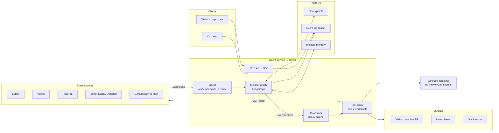
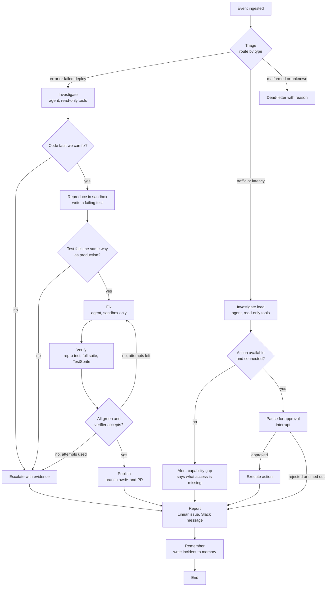
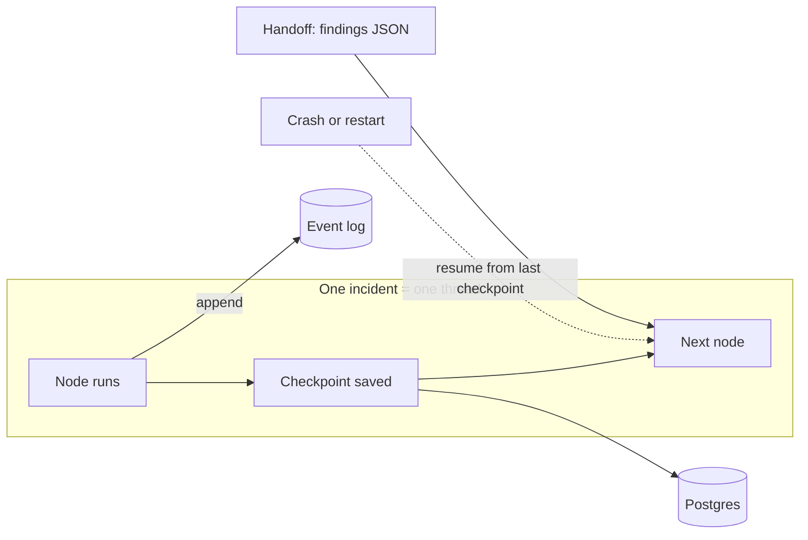
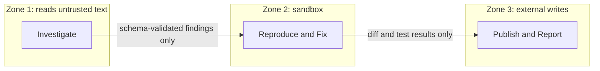
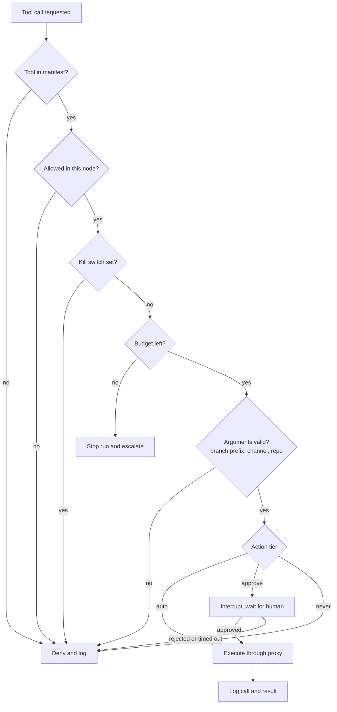
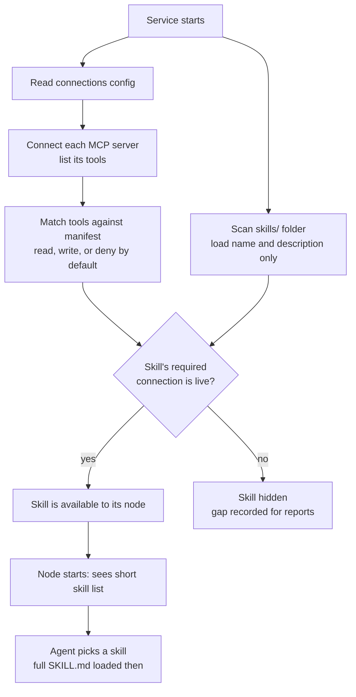
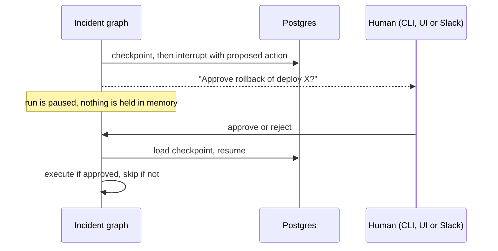

# AgentWatchdog architecture

Status: design. Nothing in `agent/` is built yet. Items marked *(open)* are undecided and tracked in [Decision.md](Decision.md).

## 1. What it is

AgentWatchdog is an autonomous first responder for production incidents. A production signal arrives (a Sentry error, a failed deploy, a traffic or latency alert). The agent investigates it, reproduces it in a sandbox, writes a fix, proves the fix with tests, opens a pull request on its own branch, files a Linear issue and reports to Slack. A human only merges.

It is not a code reviewer. It never triggers on "PR opened". It triggers on production signals.

Three rules define the product:

1. **No reproduction, no PR.** A fix is only published if a test that failed before the fix passes after it.
2. **Stops are enforced in code.** Budgets, permissions and the kill switch live in the harness, never in a prompt.
3. **Every run leaves a trace.** What it saw, what it decided, which tools it called, what came back.

## 2. System overview

Two processes, one source of truth:

| Part | Runs with | Port | Role |
|---|---|---|---|
| Agent service | `docker compose up` | 8787 | Webhook ingest, incident graph, API |
| Postgres | `docker compose up` | 5432 | Checkpoints, event log, memory |
| Web UI | `pnpm dev` | 3000 | Read-only view plus approve and stop |
| CLI | `awd` | n/a | Same API as the UI |

The UI and the CLI are both thin clients of the agent API. Neither holds state, so either can be used alone.

## 3. The incident graph

Control flow is fixed in code as a LangGraph `StateGraph`. The model directs its own steps only inside the two agent nodes, **investigate** and **fix**. Everything else is deterministic.

| Node | Kind | Tools it may use | Output |
|---|---|---|---|
| Triage | Code plus one classification call | None | Route and severity |
| Investigate | Agent loop | Read-only: logs, errors, metrics, repo read, memory | Structured findings |
| Reproduce | Agent loop in sandbox | Sandbox shell and files | Failing test, or "not reproduced" |
| Fix | Agent loop in sandbox | Sandbox shell and files | Diff |
| Verify | Code, then a separate sceptical model call | Sandbox test runner, TestSprite | Pass or fail with reasons |
| Publish | Code | GitHub: create branch, open PR | PR link |
| Report | Code with templated text | Linear create issue, Slack post | Links |
| Escalate | Code | None | Evidence bundle |

Why verify is split: an agent grading its own work approves too easily. The gate is test exit codes. The separate verifier only answers what code cannot: does the repro test match the production stack trace, and did the fix merely swallow the exception or weaken a test.

## 4. Harness

The harness is everything around the model that makes a run durable and inspectable.

- **Durability.** Each incident is one LangGraph thread, checkpointed to Postgres after every node. A crashed service resumes from the last checkpoint.
- **Idempotency.** The thread id is derived from the event fingerprint, so a storm of identical errors is one run. Side-effecting nodes (publish, report) record an idempotency key before acting, so a resume does not open a second PR.
- **Fresh context per phase.** Nodes do not share a chat history. Each receives a structured handoff (findings, repro result, diff). This keeps context small and is also a security boundary (section 5).
- **Trace.** Every model call, tool call, guardrail decision and state change is appended to the event log. The CLI and the UI render the same log.
- **Memory.** After each run the incident is stored: fingerprint, root cause, fix, and whether a human merged or closed the PR. Investigate retrieves similar past incidents. A closed PR is a negative example.
- **Sandbox.** One disposable container per run. It has the repo, no network and no secrets. If it dies it is recreated from the same recipe.

## 5. Guardrails

### 5.1 Trust zones

Webhook payloads, logs, error messages, commit messages and repo content are all untrusted. The rule: once a phase has read untrusted text, that text must not be able to cause a consequential action.

| Zone | Reads untrusted text | Holds secrets | Can write externally |
|---|---|---|---|
| 1 Investigate | Yes | No | No |
| 2 Reproduce and Fix | Validated findings, repo content | No | No (sandbox has no network) |
| 3 Publish and Report | No free text; templated fields | Through the proxy only | Branch `awd/*`, one Slack channel, one Linear project |

No zone has all three. Zone 3 text is built from templates, so injected text cannot choose a recipient, a channel or a repository.

### 5.2 The check on every tool call

### 5.3 Action tiers

| Tier | Actions |
|---|---|
| Auto | Read any connected source, run code in the sandbox, push to `awd/*`, open a PR, create a Linear issue, post to the configured Slack channel |
| Approve | Rollback, feature-flag change, scaling, anything that costs money or changes production |
| Never | Merge, deploy, push to main, force-push, touch production data, message any person named in event content |

The "never" tier is not a rule the model follows. Those tools do not exist in the tool proxy.

### 5.4 Stop conditions

| Condition | Result |
|---|---|
| Per-run cost, time or tool-call budget reached | Run stops, escalates with what it has |
| Per-day cost or PR cap reached | New runs queue; one alert is sent |
| Bug not reproduced | Escalate, no PR |
| Fix attempts exhausted (3) | Escalate with the failing output |
| Incident caused by the agent's own earlier fix | One retry, then escalate |
| Approval not given in time | Action skipped, reported as skipped |
| Kill switch (`awd stop`, UI, Slack) | Run halts at the next tool call |
| Malformed or unsigned webhook | Dead-letter queue with the reason |

### 5.5 Identity and consent

- Commits, PRs, issues and messages come from a bot identity and say they were written by an agent.
- Output goes only to the channel and project the installer configured.
- Credentials stay in the tool proxy. The model and the sandbox never see them.

## 6. Connections and skill discovery

Connections give the agent abilities. Skills tell it how to use them.

- **Connections.** Each service is an MCP server listed in one config file. On start the service connects, lists tools and classifies each against a manifest. A tool that is not in the manifest is denied.
- **GitHub writes** *(open)* go through a scoped GitHub App called directly, not through MCP, so the branch restriction is enforced by the token itself.
- **Skills.** Each runbook is a folder in `skills/` with a `SKILL.md` in the Agent Skills format. Frontmatter carries `name`, `description`, and metadata naming the connection it needs and the node it belongs to.
- **Progressive disclosure.** Only names and descriptions are loaded at start. The body loads when the agent activates the skill. Scripts in the skill folder do the deterministic steps.
- **Missing connection.** If Linear is not connected, `file-linear-issue` is hidden and the Slack report says the issue was not filed and why. The agent reports gaps instead of failing silently.

Note: `skills/` holds runbooks the product uses at run time. `.claude/skills/` holds skills for the coding agents that build this repo. They are separate.

## 7. Human approval

All three surfaces resume the same interrupt. A timeout counts as a rejection.

## 8. Running it

Planned commands. None exist yet.

| Command | Does |
|---|---|
| `docker compose up` | Starts Postgres and the agent service |
| `pnpm dev` | Starts the web UI |
| `awd demo` | Runs the seeded bug in `demo-app/` end to end |
| `awd replay <fixture>` | Feeds a recorded webhook to the live agent |
| `awd trace <run>` | Prints the run's event log |
| `awd approve <run>` / `awd reject <run>` | Answers a pending approval |
| `awd stop <run or all>` | Kill switch |
| `awd trap <dir>` | Runs hostile inputs and writes outcomes to `trap-results/` |

Demo mode needs one model API key. It uses the local sandbox, the bundled demo app, and file-based stand-ins for Slack and Linear.

## 9. Folder map

| Path | Holds |
|---|---|
| `src/` | Web UI (Next.js) |
| `agent/src/ingest` | Webhook endpoints, signature checks, normalising, dedupe |
| `agent/src/graph` | Incident graph, state, `nodes/` |
| `agent/src/guardrails` | Policy engine: manifest, tiers, budgets, kill switch |
| `agent/src/tools` | Tool proxy and typed tools |
| `agent/src/mcp` | MCP connections and tool classification |
| `agent/src/sandbox` | Sandbox driver |
| `agent/src/memory` | Incident memory |
| `agent/src/skills` | Skill discovery and loading |
| `agent/src/trace` | Event log |
| `agent/src/api` | HTTP API and SSE |
| `agent/src/cli` | The `awd` CLI |
| `agent/src/config` | Config and connections loading |
| `agent/tests` | Agent tests |
| `skills/` | Run-time runbooks |
| `fixtures/webhooks` | Recorded webhook payloads |
| `fixtures/trap-pack` | Hostile inputs |
| `trap-results/` | Committed results of trap runs |
| `demo-app/` | Seeded buggy app for the demo |
| `docker/` | Dockerfiles and compose files |
| `scripts/`, `docs/` | Helper scripts, extra docs |
