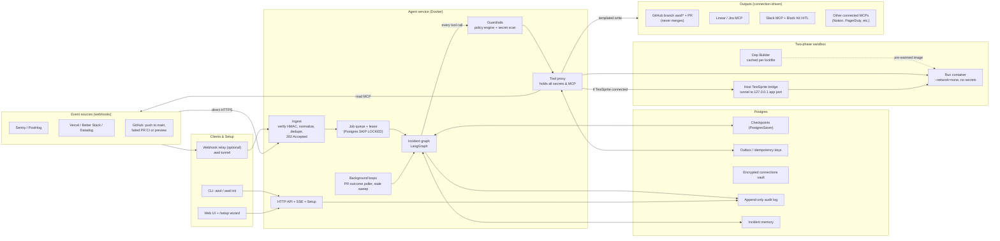
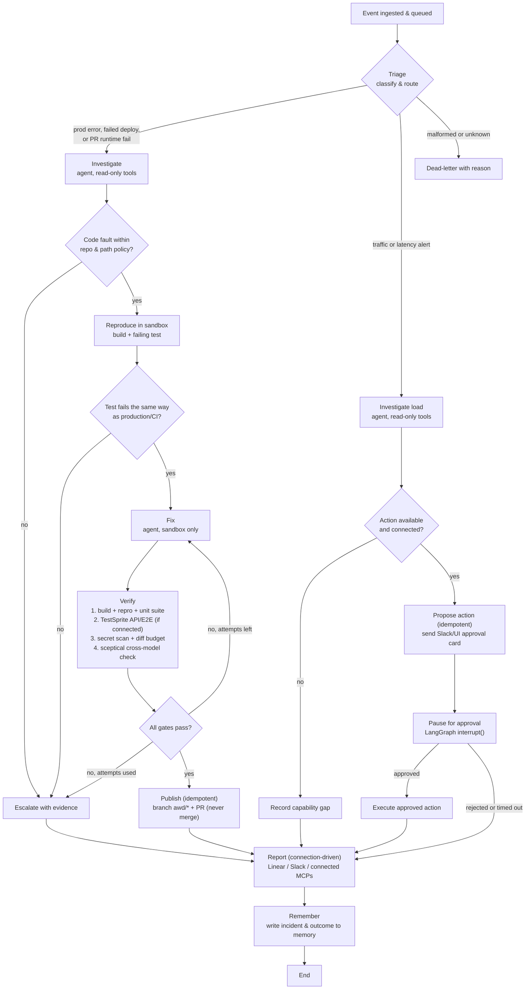
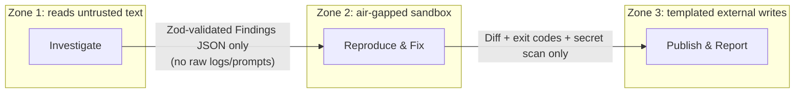
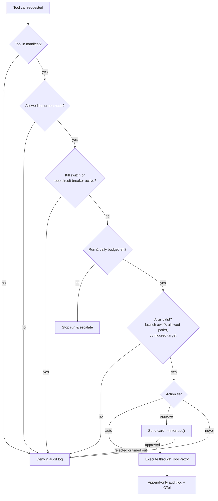
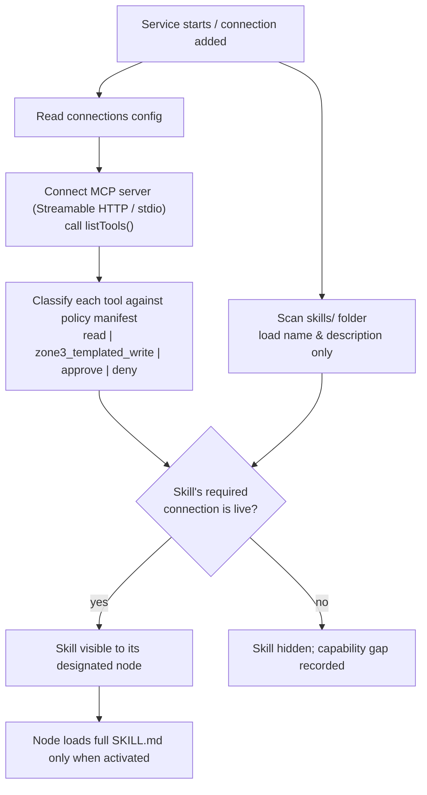

# AgentWatchdog architecture

Status: design. Nothing in `agent/` is built yet. Items marked *(open)* are undecided and tracked in [Decision.md](Decision.md).

## 1. What it is

AgentWatchdog is an autonomous, self-hosted first responder built for **individual developers and solo builders** to run on their own apps (with production-grade guardrails). You connect your own GitHub, Sentry, Linear, Slack, TestSprite, or custom MCP tools. When a production signal arrives (a Sentry error, a failed deploy, a traffic or latency alert) — or a concrete runtime failure on a pull request (failed CI check, failed preview deploy, or failed TestSprite E2E run) — the agent investigates, reproduces the failure in an air-gapped sandbox, writes a fix, proves the fix with deterministic tests and optional TestSprite E2E verification, opens a pull request on its own branch, files a Linear issue and reports to Slack (plus any connected MCP apps). **You always merge.**

It is **not** a code-review bot. It never leaves style comments on `pull_request.opened`. It triggers only on runtime signals: production errors/alerts (primary), post-merge `main` smoke regressions, and failed CI/preview/TestSprite checks on PRs (opt-in, ignoring `awd/*` branches to prevent loops).

Four rules define the product:

1. **No reproduction, no PR.** A fix is only published if a test that failed before the fix passes after it.
2. **Stops are enforced in code.** Budgets, path policies, branch restrictions, and the kill switch live in the harness, never in a prompt.
3. **Human merges, agent proposes.** No tool for merge, push-to-main, or production deploy exists in the runtime.
4. **Every run leaves a trace.** Every webhook, model call, tool decision, sandbox hash, and approval is logged durably.

## 2. System overview



Processes and responsibilities:

| Part | Runs with | Port | Role |
|---|---|---|---|
| Agent service + worker | `docker compose up` | 8787 | Webhook ingest, job queue, LangGraph runtime, tool proxy, API |
| Postgres | `docker compose up` | 5432 | Job queue, checkpoints, idempotency outbox, audit log, memory |
| Web UI | `pnpm dev` (or container) | 3000 | Live run monitor, trace viewer, `/setup` wizard, approve/stop |
| CLI | `awd` | n/a | Same API as the UI + `awd init` / `awd demo` / `awd trap` |
| Webhook relay *(optional)* | `awd tunnel` | n/a | Quick HTTPS tunnel for local setup by strangers without a public domain |

The UI and the CLI are both thin clients of the agent API. Neither holds state, so either can be used alone.

## 3. Triggers and the incident graph

### 3.1 Trigger matrix

| Signal source | Trigger event | Excluded / loop guard | Path taken |
|---|---|---|---|
| Sentry / PostHog | New or spike error / regression | Duplicate fingerprint in active window | Error-to-PR path |
| Vercel / GitHub Deploy | Failed production or preview deploy | Already handled deployment SHA | Error-to-PR path |
| GitHub `push` to `main` | Post-merge smoke or TestSprite E2E fail | Automated `awd/*` merge commits handled as self-regression check | Error-to-PR path (1 retry limit on self-regression) |
| GitHub PR runtime failure *(opt-in)* | `check_suite` / `workflow_run` failed or PR TestSprite fail | Ignores `pull_request.opened` without failure; ignores all `awd/*` branches | Error-to-PR path -> opens child PR `awd/pr-<num>-<sha>` targeting PR branch |
| Datadog / Better Stack | Traffic spike, 5xx rate, or latency alert | Alert cooldown window | Load-triage path (diagnose + HITL approval) |

### 3.2 Incident graph

Control flow is fixed in code as a LangGraph `StateGraph`. The model directs its own steps only inside **Investigate**, **Reproduce**, and **Fix**. Everything else is deterministic code (with one isolated cross-model call in **Verify**).



| Node | Kind | Tools it may use | Output |
|---|---|---|---|
| Triage | Code + small classification call | None | Route, severity, fingerprint |
| Investigate | Agent loop (Zone 1) | Read-only: logs, Sentry/metrics MCP, repo read, memory | Schema-validated `Findings` JSON |
| Reproduce | Agent loop in sandbox (Zone 2) | Sandbox shell & files (no network, no secrets) | Failing repro test + exit code + trace |
| Fix | Agent loop in sandbox (Zone 2) | Sandbox shell & files (respecting `.agentwatchdog.yml` path policy) | Patch diff |
| Verify | Deterministic gates + TestSprite bridge + sceptical model | Sandbox runner, host TestSprite CLI (if connected), secret scanner | Pass/fail + verification matrix |
| Publish | Deterministic code (Zone 3) | GitHub App (`contents:write`, `pull_requests:write` on `awd/*`) | Branch + PR link |
| Report | Deterministic templates (Zone 3) | Connected write MCPs (Linear, Slack, custom MCPs) | Issue/message links + missing-connection gaps |
| Propose / Interrupt | Code (`Propose` before `interrupt()`) | Slack Block Kit / UI / CLI | Approved/rejected decision |
| Escalate | Code | None | Structured evidence bundle |

Why `Propose` sits *before* `interrupt()`: when LangGraph resumes a paused thread via `Command(resume=...)`, the interrupted node re-runs from the top. Separating card delivery (`Propose`, guarded by an outbox idempotency key) from `interrupt()` prevents duplicate Slack messages on resume.

Why `Verify` is split: an agent grading its own patch approves too easily. Exit codes are the hard gate; a separate cross-model verifier checks whether the repro test matches the original stack trace and rejects exception swallowing (`catch {}`) or weakened assertions.

## 4. Build, Sandbox, and TestSprite Verification

### 4.1 Two-phase sandbox (how builds work without internet)

An air-gapped `--network=none` container cannot run `pnpm install` or `pip install`. AgentWatchdog solves this with two separated phases:

1. **Dependency Builder (pre-warmed, lockfile-keyed):** On onboarding and whenever lockfiles (`pnpm-lock.yaml`, `package-lock.json`, `uv.lock`) change on `main`, a build worker fetches packages (`--ignore-scripts` where supported) into a cached read-only base image/volume tagged by lockfile hash.
2. **Ephemeral Run Sandbox (per incident):** Spun up per run from the cached base image with:
   - `--network=none` (zero internet egress; optional isolated internal bridge only to a disposable test DB/Redis sidecar — never production).
   - `--cap-drop=ALL`, non-root UID, `--read-only` root filesystem with bounded `tmpfs` `/tmp` and writable `/workspace`.
   - Hard CPU, RAM, PIDs, and wall-clock timeout caps.
   - Zero production secrets — uses synthetic `.env.test` fixtures only.

### 4.2 What TestSprite runs and how it bridges the sandbox

TestSprite (`@testsprite/testsprite-cli` / `@testsprite/testsprite-mcp`) is an autonomous **cloud-executed QA engine** that generates and runs two classes of tests:
- **Backend / API tests:** Functional API workflows, HTTP contract & schema validation, auth & error handling, data integrity.
- **Frontend / E2E tests:** Real browser (Playwright) user journeys in TestSprite's cloud — navigation, forms, visual/DOM state, auth flows, console/network errors.

Because TestSprite executes in the cloud and requires `TESTSPRITE_API_KEY`, it **never runs inside the sandbox**. Instead:
1. If `TESTSPRITE_API_KEY` is connected, the sandbox boots the patched app on a single local port mapped only to `127.0.0.1:<ephemeral-port>` on the host.
2. The **host-side Tool Proxy** starts a short-lived encrypted reverse tunnel (`testsprite tunnel`) bound strictly to that single HTTP port and executes `testsprite test run --output json`.
3. **If TestSprite is not connected**, Stage 3 is skipped cleanly and reported in the PR/Slack verification matrix (`TestSprite: skipped (not connected)`), relying on the repo's local unit/integration/Playwright suite.

### 4.3 Four-stage verification pipeline

| Stage | Runs where | Must satisfy |
|---|---|---|
| 1. Reproduction proof | Air-gapped sandbox | New repro test runs **before** patch -> fails with matching error signature |
| 2. Build & local suite | Air-gapped sandbox | `build` (`tsc` / `next build`) + repro test + repo unit/integration suite -> exit `0` |
| 3. E2E & API behavioral proof *(if connected)* | Host TestSprite bridge -> patched app port | TestSprite Backend API & Frontend E2E regression tests -> exit `0` |
| 4. Policy & sceptical check | Host Tool Proxy + Verifier model | Diff within `.agentwatchdog.yml` path/line limits, zero leaked secrets, no swallowed errors or weakened tests |

## 5. Harness (Long-running & durable execution)

To run reliably for days/weeks across crashes, deploys, and slow human approvals:

- **Async ingest + leased job queue:** Webhook endpoints verify HMAC signatures, normalize events, enqueue into Postgres (`SKIP LOCKED` with worker lease & heartbeat), and return `202 Accepted` in <50ms. If a worker dies mid-run, another worker reclaims the expired lease and resumes from the last checkpoint.
- **Checkpointed state:** Each incident is one LangGraph thread (`thread_id` derived from event fingerprint + repo), persisted to Postgres (`PostgresSaver`) after every node.
- **Idempotency outbox:** Side-effecting actions (`create_branch`, `open_pr`, `linear_create_issue`, `slack_post_message`, `slack_approval_card`) write an outbox record keyed by `(thread_id, step_key)` before calling external APIs. Crash-resumes never open duplicate PRs or spam Slack.
- **Fresh context per phase:** Nodes do not share a single bloated chat transcript. Each node receives a compact, schema-validated handoff (`Findings`, `ReproResult`, `PatchSummary`).
- **Scheduled autonomous background loops:**
  - **PR outcome poller:** Checks open `awd/*` PRs (merged, closed with comments, or stale) and updates **Incident Memory** so closed PRs become negative examples for future runs.
  - **Low-severity trend sweeper:** Correlates slow-burn recurring errors across 24h windows into a single incident.
  - **Approval timeout & DLQ reconciler:** Expires unanswered HITL interrupts after configured TTL and surfaces dead-lettered events.
- **Incident memory:** Stores fingerprint, root cause, verified diff summary, and human outcome (merged vs rejected).

## 6. Guardrails & Enterprise Trust

### 6.1 Three trust zones (OWASP LLM01 defense)

Webhook payloads, logs, error messages, PR comments, and repo content are all **untrusted**. Once a phase reads untrusted text, that text can never directly trigger an external write.



| Zone | Reads untrusted text | Holds secrets | Can write externally |
|---|---|---|---|
| 1 Investigate | Yes | No | No |
| 2 Reproduce & Fix | Validated findings, repo content | No | No (`--network=none`) |
| 3 Publish & Report | Never raw free text; structured fields only | Inside Tool Proxy / KMS only | `awd/*` branch/PR, configured Slack channel, configured Linear/MCP targets |

### 6.2 Policy check on every tool call



### 6.3 Action tiers & repository change policy (`.agentwatchdog.yml`)

| Tier | Actions |
|---|---|
| Auto | Read connected sources, build/test in sandbox, push to `awd/*`, open PR, create Linear/Jira issue, post to configured Slack channel |
| Approve | Rollback, feature-flag change, scaling, edits to sensitive paths (if opted in), anything changing production state |
| Never | Merge PR, deploy to prod, push to `main`/`master`, force-push, read production DB rows, DM/email arbitrary people named in event text |

Repo-level `.agentwatchdog.yml` enforces deterministic **blast-radius caps**:
- `protected_paths`: default deny on `.github/workflows/**`, `Dockerfile*`, `infra/**`, `terraform/**`, `**/auth/**`, `**/migrations/**`.
- `max_files_changed` (default 8) and `max_diff_lines` (default 300) — fixes exceeding limits escalate to humans instead of publishing sprawling edits.
- Pre-publish **secret scanner** blocks any diff or log containing API keys, tokens, or high-entropy secrets.

### 6.4 Stop conditions & circuit breakers

| Condition | Result |
|---|---|
| Per-run token/cost, time, or tool-call budget reached | Run stops cleanly, escalates with partial evidence |
| Per-day cost or PR cap reached | New runs queue; single rate-limit alert sent |
| Bug not reproduced in sandbox | Escalate with findings, no PR |
| Fix attempts exhausted (3) | Escalate with failing output |
| Self-regression (incident on commit merged from `awd/*`) | One retry allowed, then auto-pause repo & escalate |
| Approval timeout | Action skipped, logged and reported as skipped |
| Kill switch (`awd stop`, UI, Slack `/awd stop`) | Halts at next tool check and cancels active sandbox container |
| Malformed or unsigned webhook | Rejected at ingress (`401`/`400`), recorded in DLQ |

### 6.5 Enterprise compliance & auditability

- **Bot identity:** Every commit, PR, Linear issue, and Slack message is authored by the dedicated bot identity and clearly labeled as agent-generated with trace links.
- **Immutable audit trail + OpenTelemetry:** Append-only event log records webhook signature check, model ID, token cost, policy verdicts, diff SHA, sandbox output hash, and approver identity; exports spans via OTel to enterprise SIEM/observability tools.
- **Adversarial verification (`awd trap`):** Built-in trap pack tests prompt injections embedded in Sentry payloads, stack traces, and mock repo files to prove 100% policy enforcement before deployment.

## 7. Connections, MCP registry, and Skill discovery

Connections give the agent capabilities; skills teach each node how to use them; guardrails decide what is permitted.

### 7.1 Connection-driven matrix

| Category | Built-in / First-class | Extensible via MCP | If disconnected |
|---|---|---|---|
| Triggers & telemetry | Sentry webhook + MCP, Vercel, PostHog, GitHub checks | Datadog, Better Stack, Grafana, PagerDuty, read-only Postgres MCP | Agent relies on remaining active sources |
| Code & PRs | GitHub App (scoped token, `awd/*` only) | GitLab / Bitbucket *(future)* | Dry-run patch bundle exported locally |
| Verification | Local Sandbox Test Runner (always on) + TestSprite CLI/MCP | Custom test runner command in `.agentwatchdog.yml` | Runs local suite only; notes TestSprite skipped |
| Issue tracking | Linear (`https://mcp.linear.app/mcp`) | Jira, GitHub Issues MCP | Issue creation skipped; gap noted in Slack/UI |
| Chat & HITL | Slack (`https://mcp.slack.com/mcp` + Block Kit) | MS Teams, Discord, PagerDuty MCP | Approvals & reports fall back to Web UI & CLI |
| Postmortems / Docs | — | Notion, Confluence MCP | Skipped; summary stays in PR & UI trace |

### 7.2 Zero-trust MCP discovery



- **Default deny:** Any newly discovered MCP tool not explicitly allowlisted in the policy manifest is denied by default.
- **Zone-restricted MCP writes:** Write tools from Linear, Slack, Notion, or Jira MCP servers can only be invoked by Zone 3 (`Report`) using strict schema templates — never directly by Zone 1 (`Investigate`) or Zone 2 (`Fix`).
- **Skills separation:** `skills/` holds runtime runbooks (`triage-sentry-error`, `reproduce-bug`, `write-fix`, `file-linear-issue`, `post-slack-report`, `traffic-spike-triage`, `escalate`). `.claude/skills/` holds coding-agent skills for developing this repository.

## 8. Human approval (HITL)

```mermaid
sequenceDiagram
    participant P as Propose node
    participant I as Interrupt node
    participant DB as Postgres (Outbox + Checkpoints)
    participant H as Human (Slack, UI, or CLI)
    P->>DB: check outbox idempotency key
    P-->>H: send signed approval card ("Approve rollback of deploy X?")
    P->>I: transition to interrupt()
    I->>DB: checkpoint state, yield worker
    Note over I,DB: Run paused; zero RAM/connections held
    H->>I: click Approve or Reject (single-use signed token)
    I->>DB: load checkpoint, resume with Command(resume)
    I->>I: execute approved action or skip
```

All three surfaces (Slack Block Kit button, Web UI, `awd approve` CLI) resolve the same LangGraph thread and single-use signed token. Timeout counts as rejection.

## 9. UI, Auth, and Database (per-user, no teams)

Rox has two ways in. **Quick Judge Mode** (`user_id = demo`) needs no account: it runs the bundled `demo-app/` against mock GitHub, Linear and Slack adapters. **Real mode** is for people who sign in with GitHub and install the Rox GitHub App on their own repos. Every user is an individual with their own repos and connections. There are **no organizations, teams or RBAC**.

### 9.1 GitHub identity and repo access (real mode)

One public GitHub App, **Rox WatchDog** (`rox-watchdog`), is registered once by the project owner. Users install it on the repos they choose; they never create webhooks. We use a GitHub App rather than an OAuth app because an OAuth `repo` scope means full control of every private repo, while an App shows a short permission list and a repo picker.

- **Sign-in and install in one step:** "Request user authorization during installation" is on, so GitHub redirects to `/api/auth/github/callback` with `code` and `installation_id`. The callback exchanges the code, then checks that the installation really belongs to the signed-in user (`GET /user/installations`) before saving anything.
- **Stored per user:** the GitHub user id and the installation id. No GitHub token is stored. Every sign-in creates or refreshes a row in the `users` table and appends an `auth.sign_in` event to the audit log (sign-out appends `auth.sign_out`). The browser session is still a signed, HTTP-only cookie (`rox_session`, HMAC-signed with `SESSION_SECRET`, 7 days) holding the database user id and the verified installation ids. The agent service will need an installation-to-user table in Postgres to route webhooks; that table does not exist yet.
- **Quick Judge Mode users:** each visit to `/api/auth/demo` creates a new user (random `user-xxxxxxxx` login, display name "User", `is_demo = true`, no GitHub id), so judges never share an identity and never install anything or share credentials.
- **Sign-in landing:** both paths end at `/auth/callback`, which shows "Starting Agent server", "Loading environment" and "Checking server health", then goes to `/home?welcome=1` for a welcome toast. Only the last step is a real check: `GET /api/health` runs `SELECT 1` against Postgres and confirms the server is configured. The first two steps are timed placeholders until the agent service exists. If the check fails the page shows an error with "Try again".
- **Already signed in:** `/auth` checks the session first. A valid, unexpired session (GitHub or Judge) shows a "Welcome back" loading toast and goes straight to `/home`; the sign-in page is skipped.
- **Route protection:** `src/proxy.ts` (Next 16's replacement for middleware, Node.js runtime) runs before every `/home` and `/home/*` request. No valid, unexpired session means a redirect to `/auth` and the bad cookie is cleared. `src/app/(app)/home/layout.tsx` checks the session again, so a page never renders for a signed-out visitor even if the proxy is bypassed.
- **Mode badge and switch button:** the sidebar always shows the mode above Home. A judge session shows "Quick Demo Mode: On" (click for an explanation) and a header button "Try live in the real world", which signs out and returns to `/auth?notice=github` with a toast recommending GitHub. A real GitHub session shows a fixed "Quick Demo Mode: Off" label (not a switch) and a header button "Try Quick Judge Mode", which signs out and returns to `/auth?notice=judge` with a toast pointing to Quick Judge Mode. Logout accepts only the exact values `real` and `judge` for `reason`; anything else goes to plain `/auth`, so the redirect cannot be steered.
- **Home content:** a setup guide for everyone. For GitHub users it tracks real progress (signed in, repositories chosen) and marks the rest "Coming next". For judges it is a walkthrough plus a table of what is real and what is test mode (9.2).
- **Home shell:** every `/home` page sits inside a sidebar (logo, navigation, and the user's picture or first initial, name and email) and a header with a Logout button. Planned pages show as "Soon" until they exist. The email comes from the user's public GitHub profile (Rox does not request the email permission), so it is often empty; the sidebar then shows `@login`, or "Quick Judge session" for judges.
- **Token minting:** each run mints a 1-hour installation token for one repo, read-only for Investigate and write only inside Publish.
- **One webhook for all repos:** `POST /api/ingest/github`, signature-checked. The installation id maps an event to a user. `installation` and `installation_repositories` events keep the repo list current when users add or remove repos.
- **Permissions requested:** Metadata read; Contents read and write; Pull requests read and write; Checks read; Actions read. Not requested: Workflows (GitHub then blocks edits to `.github/workflows/` as a second layer behind `protected_paths`), Administration, Secrets, Issues. Events: Push, Check suite, Workflow run, Pull request.
- **Not covered by the App:** Sentry, Vercel and Datadog alerts still need a per-user webhook URL (`/api/ingest/:userId/...`).
- **Disclosure:** the stack trace and the relevant files of a private repo are sent to the configured model provider.

### 9.2 Quick Judge Mode (test mode)

Rule: build against a test account or a sandbox, document how a judge can do the same, and never ask a judge for their own credentials. A judge session runs the same agent, graph and guardrails as a real session. Only the adapters at the edges differ, chosen by session mode (`is_demo`) behind one interface per integration.

| Part of a run | Quick Judge Mode | Real mode |
|---|---|---|
| Alert source | Recorded fixture replayed into the ingest path | Your Sentry, Vercel or PostHog webhook |
| Code, tests, k6, security scans | **Real**, in the local Docker sandbox, on the bundled `demo-app/` | **Real**, in the local Docker sandbox, on your repo |
| Model | Operator's capped demo budget; optional bring-your-own key (the only credential a judge may give) | Your model key, stored encrypted |
| Pull request | Real git branch `awd/*` and diff in a local repository, rendered as a PR card in Rox. Nothing is pushed anywhere. | Draft PR through the GitHub App |
| Linear issue | Preview card stored in our database | Real issue |
| Slack report and Approve | Preview card with a working Approve button that resumes the real paused run | Real Slack message and Block Kit button |
| Fallback | Recorded trace replay if the demo budget is used up | n/a |

Test-mode adapters write to our own tables so the UI renders them like the real thing. Every judge session has its own user, its own run data and its own audit trail.

- **Web UI (`src/`, Next.js App Router):** Thin client over the agent's HTTP + SSE API:
  - **Routes:** `/` redirects to `/auth` (people come to see the agent, not a brochure). The marketing page is at `/web`. Signed-in pages live under `/home`.
  - **Live Monitor (`/home`):** Active runs, current graph node, token/cost used, and 1-click Kill Switch.
  - **Trace & Diff Viewer (`/runs/[id]`):** Step-by-step audit log, before/after test exit codes, TestSprite report, diff, and PR/Linear/Slack links.
  - **Approvals (`/approvals`):** Pending HITL actions (`Approve` / `Reject`).
  - **Connections & Setup (`/setup`, `/connections`):** Connect **your** GitHub, Sentry, Linear, Slack, TestSprite, and custom MCPs via OAuth/tokens with live **Test Connection** buttons.
- **Auth:**
  - **Dashboard & API:** Real mode uses a signed HTTP-only session cookie issued after GitHub sign-in (see 9.1); Judge Mode gets a session for `demo`. The `awd` CLI uses a bearer token stored hashed in Postgres. Self-hosters can skip GitHub sign-in with a local setup token.
  - **App connections & webhooks:** Incoming webhooks verify HMAC signatures. Your connected OAuth/API tokens (GitHub App PEM, Slack, Linear, Sentry, TestSprite, MCPs) are encrypted at rest in Postgres (`AES-256-GCM` via `ENCRYPTION_KEY`) and decrypted only inside the Tool Proxy.
- **Database (single Postgres 17 instance, in Docker next to the agent):** Holds LangGraph `PostgresSaver` checkpoints, the `SKIP LOCKED` job queue, idempotency outbox, encrypted connections vault, append-only audit log, and incident memory. Only `users` and `audit_events` exist so far; other tables are added as the features that need them are built.
  - **Placement:** The database runs wherever the agent runs, on the same host, bound to `127.0.0.1` only. It is never reachable from the network, and the Vercel UI never connects to it (the UI talks to the agent API). There is no cold start and no network hop. `DATABASE_URL` is the only setting, so a hosted Postgres can be swapped in later; if so, use a direct connection (not a transaction pooler), because the queue and checkpointer need advisory locks and session features.
  - **Durability:** Data lives on the named Docker volume `rox_rox_pgdata`, which survives container removal. `pnpm db:backup` writes a verified `pg_dump` to `backups/` (git-ignored), keeps the newest 14, and also copies to `BACKUP_COPY_DIR` when set. A backup that stays on the same disk does not count; point `BACKUP_COPY_DIR` at another drive or synced folder, and schedule the command nightly. `pnpm db:restore <file> --into rox_restore_check` proves a backup restores.
  - **Two roles:** `rox_owner` runs migrations and backups. `rox_app` is what the services use: it can read and append audit rows, never change or remove them, and cannot delete users.
  - **Tamper-evident audit log:** `audit_events` is append-only for every role (triggers block update, delete and truncate). Each row stores the SHA-256 hash of the row before it; the database assigns the sequence number, timestamp and hash so callers cannot choose them. `audit_chain_status()` recomputes the chain and reports the first bad row. Known limit: removing rows from the very end of the log is not detectable from inside the database, so the latest hash should also be recorded outside it (a run's trace, Slack report or backup).
  - **Migrations:** plain SQL files in `agent/migrations/`, applied once each by `scripts/migrate.mjs`, with a checksum so an applied file cannot be edited silently. `pnpm db:selftest` proves the guarantees above on a throwaway database.

## 10. Zero-friction setup (for strangers)

Anyone should be able to try Demo Mode in 60 seconds and connect their own stack in under 5 minutes:

1. **Instant Demo Mode (`awd demo`):** Needs only `OPENAI_API_KEY` (or configured model key). Uses `docker compose up`, the bundled `demo-app/`, seeded webhook fixtures, and local Slack/Linear preview files.
2. **Guided Setup Wizard (`awd init` or Web UI `/setup`):**
   - **Preflight check:** Verifies Docker socket access, Postgres readiness, sandbox base image, and LLM key.
   - **Hosted versus self-hosted GitHub App:** The hosted demo uses the single registered Rox WatchDog App (section 9.1); users only install it. The manifest flow below is for **self-hosters** who need their own App.
   - **1-Click GitHub App Manifest Flow (self-host):** The `/setup` page posts a least-privilege GitHub App manifest to `github.com/settings/apps/new`. You click **Create GitHub App**, GitHub redirects back with a temporary `code`, and the backend exchanges it automatically for `APP_ID`, `WEBHOOK_SECRET`, and the private `.pem` key — no manual permission checkboxes or key copy-pasting.
   - **Built-in Webhook Relay (`awd tunnel`):** Optional tunnel profile (Cloudflare Quick Tunnel / `smee.io`) gives your local machine an instant public HTTPS webhook URL for GitHub, Sentry, and Slack without configuring DNS or ngrok.
   - **Auto-Detected `.agentwatchdog.yml`:** Scans your target repository (`package.json`, `pyproject.toml`, `Dockerfile`, `.github/workflows`) to pre-populate build, test, and start commands plus protected paths, then runs a **1-click Sandbox Dry-Run** to verify builds and tests pass before real incidents arrive.
   - **Connection Status Board:** Interactive cards to connect your Sentry, Linear, Slack (OAuth / API token), TestSprite, and custom MCP servers with **"Test Connection"** buttons and clear previews of what skips gracefully if disconnected.

## 11. Running it

Planned commands (not yet implemented):

| Command | Does |
|---|---|
| `docker compose up` | Starts Postgres, worker/agent service, and optional webhook relay (today: Postgres only) |
| `pnpm db:up` / `pnpm db:migrate` | Starts Postgres and applies pending migrations (built) |
| `pnpm db:backup` / `pnpm db:restore` | Verified backup and restore (built) |
| `pnpm db:selftest` | Proves append-only, tamper detection, concurrency and latency on a scratch database (built) |
| `pnpm db:psql` | Opens a SQL shell inside the container (built) |
| `pnpm dev` | Starts the Web UI (dashboard, trace viewer, `/setup` wizard) |
| `awd init` | Interactive CLI onboarding + repo `.agentwatchdog.yml` auto-detection |
| `awd demo` | Runs the seeded bug in `demo-app/` end to end |
| `awd tunnel` | Exposes local webhook ingest URL for Sentry/GitHub/Slack testing |
| `awd replay <fixture>` | Feeds a recorded webhook to the live agent |
| `awd trace <run>` | Prints the run's full audit event log |
| `awd approve <run>` / `awd reject <run>` | Answers a pending HITL approval |
| `awd stop <run or all>` | Global or per-run kill switch |
| `awd trap <dir>` | Runs hostile prompt-injection inputs and writes outcomes to `trap-results/` |

## 12. Folder map

| Path | Holds |
|---|---|
| `src/` | Web UI (Next.js App Router: live monitor, trace viewer, `/setup` wizard) |
| `agent/src/ingest` | Webhook endpoints, HMAC checks, normalization, dedupe, `202` enqueue |
| `agent/src/queue` | Postgres `SKIP LOCKED` job queue, worker leases, scheduled loops |
| `agent/src/graph` | Incident `StateGraph`, state schema, `nodes/` |
| `agent/src/guardrails` | Policy engine: manifest, tiers, `.agentwatchdog.yml` path/diff rules, secret scan, budgets, kill switch |
| `agent/src/tools` | Tool proxy, idempotency outbox, GitHub App client, TestSprite host bridge |
| `agent/src/mcp` | Remote & stdio MCP connections, `listTools()` inspection, manifest classification |
| `agent/src/sandbox` | Two-phase dependency builder & air-gapped Docker run driver |
| `agent/src/memory` | Incident memory (fingerprints, root causes, PR merge/close feedback) |
| `agent/src/skills` | Runtime skill discovery and progressive loading (`skills/`) |
| `agent/src/trace` | Append-only audit log and OpenTelemetry exporter |
| `agent/src/api` | HTTP API, SSE stream, GitHub App manifest callback, Slack interactive webhook |
| `agent/src/cli` | The `awd` CLI |
| `agent/src/config` | Config, connections registry, and `.agentwatchdog.yml` loader |
| `agent/tests` | Unit, integration, and trap-runner tests |
| `skills/` | Run-time runbooks (`SKILL.md` folders) |
| `fixtures/webhooks` | Recorded webhook payloads (Sentry, Vercel, PostHog, GitHub PR/CI failure) |
| `fixtures/trap-pack` | Hostile prompt-injection and policy-bypass test inputs |
| `trap-results/` | Committed results of trap runs |
| `demo-app/` | Seeded buggy app for the 60-second demo |
| `docker/` | Dockerfiles, sandbox base image, compose files |
| `agent/migrations` | Numbered SQL migrations (`0001_init.sql`: users and audit log) |
| `compose.yaml` | Postgres service with the named volume `rox_pgdata` |
| `backups/` | Local database dumps (git-ignored, contains real data) |
| `scripts/`, `docs/` | Database scripts (migrate, backup, restore, selftest), `Research.md`, extra docs |
