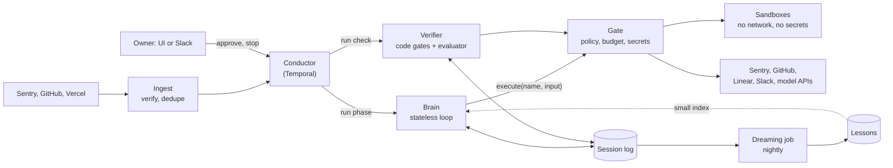
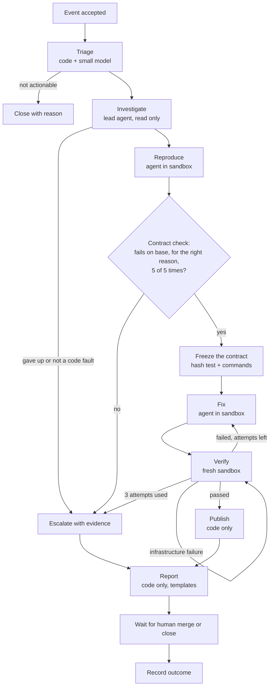
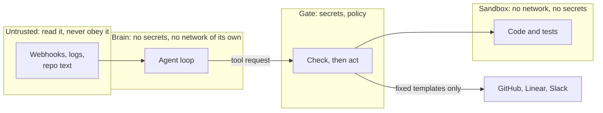

# Rox agent: final design

Date: 2026-11-24. Status: design, nothing in `agent/` is built yet.

Tags like `[S3]` point to the source list in `C:\Users\rox\Downloads\ClaudeRoxAgentBrain.md`. Anything without a tag is our own engineering decision.

Temporal is the chosen engine for background work. This document says what Rox needs from it and stops there. The owner's Temporal guide decides how.

---

## 1. The design in one minute

A production error arrives. Rox starts one **run**. The run is a fixed sequence written in code, and the model is free to think only inside three phases: Investigate, Reproduce and Fix.

Rox is built from five parts that can each crash without losing the run:

| Part | What it is | If it dies |
|---|---|---|
| **Session** | Append-only log of everything that happened, in Postgres | It is the source of truth, so back it up |
| **Conductor** | Durable workflow that owns the order of steps, timers, approvals and retries (Temporal) | Resumes where it was |
| **Brain** | Stateless loop that calls the model and routes its tool calls | A new one reads the session and continues |
| **Hands** | Sandboxes and tools, all called the same way | Becomes a tool error; a new one is created |
| **Gate** | The only process that holds secrets and checks policy | Calls fail closed; the run waits |

Session, brain and hands as separate parts come from Managed Agents [S1]. The conductor and the gate are what Rox adds, because Rox runs a known process and acts on other people's repositories.



---

## 2. The rules, and why each exists

| # | Rule | Why |
|---|---|---|
| 1 | The model never holds control flow, credentials or the final say on quality | [S1] [S3] |
| 2 | Every event is stored before anything depends on it | A summary loses information unless the original is kept [S1] |
| 3 | No accepted repro test, no fix phase. No verified fix, no PR | An autonomous agent solves whatever the checker measures, so the checker must be nearly perfect [S13] |
| 4 | The agent that writes the fix never grades it | Agents praise their own work [S3] |
| 5 | Every agent can stop honestly with `give_up` | Impossible tasks push agents to work around limits [S12] |
| 6 | Limits are enforced by the gate and the sandbox, not by prompts | Model defenses always miss some cases [S9] |
| 7 | Text from outside stays untrusted, even after an agent has summarized it | Passing through a sub-agent does not raise trust [S9] |
| 8 | Each phase starts with a fresh, small context built from the session | Accuracy drops as context grows [S2] |
| 9 | Every harness part has an off switch and a measured reason to exist | Parts go stale as models improve [S3] |

---

## 3. How a run flows



| Phase | Who decides | May use | Must produce |
|---|---|---|---|
| Triage | Code, plus one cheap classification | Nothing | Route and fingerprint |
| Investigate | Lead agent, up to 3 read-only helpers | Search logs, read events, search and read code | `Findings` |
| Reproduce | Same kind of agent, new context | Sandbox shell and files | A failing test |
| Contract check | Code | Fresh sandbox | Frozen contract |
| Fix | Agent, new context | Sandbox shell and files | A patch |
| Verify | Code gates, then evaluator | Fresh sandbox | Verdict with evidence |
| Publish, Report | Code only | GitHub, Linear, Slack through the gate | Links |

**One worker at a time.** Investigate may use parallel helpers because reading splits well. Fix never does: one bug is one coupled problem, and parallel agents on one problem overwrite each other [S13], at about 15x the tokens of a chat [S5].

**No planner agent.** Anthropic's planner expands a vague one-line request [S3]. Rox's input is a concrete error, so `Findings` plus the contract do that job. Add a planner only if evals show a gap.

---

## 4. Interfaces

These five shapes are the part meant to last. What sits behind them can change.

```ts
// Session: append-only, the source of truth
emitEvent(runId, event): Promise<{ seq: number }>
getEvents(runId, { from, to, types }): Promise<Event[]>

// Brain: holds nothing between calls
wake(runId, phase): Promise<PhaseResult>

// Hands: every tool, sandbox or API has this shape
execute(ctx, name, input): Promise<string>
provision(spec): Promise<HandId>
destroy(handId): Promise<void>

// Verifier
verify(runId, contractHash, patchRef): Promise<Verdict>

// What Rox needs from the conductor
startOnce(incidentKey, input)      // same key never starts two live runs
signal(runId, "approve" | "stop")
waitFor(condition, timeout)        // survives restarts, costs nothing while waiting
```

`PhaseResult` is one of `done`, `gave_up`, `budget_exhausted`, `stopped`. There is no silent success.

**Conductor history holds references only.** Logs, diffs and transcripts go to the session and blob store; the conductor sees IDs and verdicts.

---

## 5. The brain loop

```ts
async function wake(runId, phase) {
  await reconcileUnfinishedCalls(runId, phase);      // see section 6
  for (;;) {
    const stop = await gate.check(runId, phase);      // kill switch, budget, time
    if (stop) return finish(runId, phase, stop);

    const context = buildContext(await getEvents(runId, { phase }), phase);
    const reply = await model.call(phase, context);
    await emitEvent(runId, { type: "model.reply", reply });

    if (reply.final) return acceptOrRetrySchema(runId, phase, reply);

    for (const call of reply.toolCalls) {
      await emitEvent(runId, { type: "tool.requested", call });   // before acting
      const result = await gate.execute(runId, phase, call);
      await emitEvent(runId, { type: "tool.completed", call, result });
    }
  }
}
```

- It is plain TypeScript over the model APIs. Anthropic advises starting with the API directly because frameworks hide prompts and make debugging harder [S17].
- If a claim of completion has no accepted output, the loop asks once more against the written criterion, then ends the phase. This limits early stopping [S14] without looping forever.
- The harness shows time and budget left on each tool result, because models cannot feel time [S13].

---

## 6. Crash recovery

The dangerous moment is after an action happens and before it is recorded. So a request is always logged first, and on wake every `tool.requested` without a `tool.completed` is settled:

| Kind of call | What recovery does |
|---|---|
| Read only | Run it again |
| Sandbox command | Destroy the sandbox, rebuild from base plus the last saved patch, tell the agent |
| External write | Ask the outside service whether it already happened, then record or do it |

External writes use names that can be looked up: branch `awd/<run>-<attempt>`, one PR per branch, and a run marker inside each Linear issue and Slack message. Work can be attempted twice; it must never land twice.

| Failure | Result |
|---|---|
| Brain process dies | Conductor starts a new one; it continues from the last event |
| Sandbox dies | Tool error to the agent, new sandbox; counted as infrastructure, not as a fix attempt |
| Model API down or rate limited | Wait and retry in one place only; after a limit, pause the run |
| Postgres down | Nothing proceeds. Fail closed |
| Gate down | No tool call succeeds. Fail closed |
| Owner presses stop | Gate refuses the next call at once, running sandboxes are destroyed, the workflow is cancelled, and the tail of the log is kept |
| New version deployed mid-run | Old runs finish on the old version [S5] |

Stop is enforced at the gate first, since that does not depend on the agent noticing.

---

## 7. Context per phase

Each phase gets a new context. Nothing is carried over as chat history.

| Phase | Sees at start | Loads when needed | Never sees |
|---|---|---|---|
| Investigate | Error summary, stack frames, repo map, matching lessons | Log search, code search, file reads | Credentials, write tools |
| Reproduce | `Findings`, test conventions, commands | Files in the sandbox | Raw logs, webhook text |
| Fix | `Findings`, frozen contract, failed-attempts list | Files in the sandbox | Raw logs, evaluator prompt |
| Evaluator | Contract, diff, test results, stack signature | Files around the diff | The fixer's reasoning |

- **Order for caching:** stable instructions, then tools, then skill, then run facts, then the moving part.
- **Tool output:** a few lines in context, the full text saved and referenced, errors on one searchable line [S13].
- **When context fills:** clear old tool results first [S2]. Only then compact. Both are reversible because the session keeps everything. Use a full reset only if evals show a model wraps up early; some models needed it and later ones did not [S3].
- **Failed attempts are carried forward** as "tried, result, why it failed", so the next attempt does not repeat them [S14].
- **Helpers return 1,000 to 2,000 tokens** [S2] with evidence IDs, not prose retellings.

---

## 8. Tools

Small sets per phase, each shaped around a job rather than an API endpoint [S7].

| Tool | Phase | Notes |
|---|---|---|
| `incident_context` | Investigate | One call for error, frames, release and recent deploys |
| `logs_search` | Investigate | Returns matches with a little context, concise or detailed |
| `code_search`, `code_read` | Investigate | Pinned to one commit, read only |
| `shell` | Reproduce, Fix | Sandbox only, output truncated with a saved log |
| `file_edit` | Reproduce, Fix | Absolute paths only, since relative ones caused errors [S17] |
| `run_tests` | Reproduce, Fix | Fast and full modes, compact result |
| `session_search` | All | Reread earlier events on purpose |
| `submit` | All | Schema-checked output that ends the phase |
| `give_up` | All | Reason code plus evidence. A valid, respected result |

There is no tool for merge, deploy, push to main, or arbitrary network access in any phase.

---

## 9. The contract

Reproduce proposes it and code accepts it. This is Rox's form of agreeing what "done" means before work starts [S3].

```json
{
  "incident": "…",
  "base_commit": "…",
  "test_file": "tests/awd/checkout-null-cart.test.ts",
  "test_sha256": "…",
  "expected_failure": { "error": "TypeError", "frame": "src/cart.ts:totalFor" },
  "commands": { "build": "…", "repro": "…", "suite": "…" },
  "limits": { "max_files": 8, "max_lines": 300 },
  "must_not_change": [".github/**", ".agentwatchdog.yml", "**/migrations/**", "**/auth/**", "tests/awd/**"]
}
```

Accepted only if, in a fresh sandbox on the base commit:

1. the new test fails 5 out of 5 times;
2. the failure matches the production error type and at least one production frame;
3. the existing suite gives the same result with and without the new test.

Then it is frozen by hash. The Fix agent cannot change its own exam. Commands and policy are read from the **base commit**, never from patched files, because project config is attacker-controlled input until proven otherwise [S9].

---

## 10. Verify

Runs in a **new** sandbox: base commit, plus the patch, plus the frozen test. Nothing from the Fix sandbox counts.

| Gate | Type | Pass means |
|---|---|---|
| 1. Contract intact | Code | Test hash, protected paths and size limits unchanged |
| 2. Fail to pass | Code | Repro test passes 5 of 5 |
| 3. Pass to pass | Code | Everything that passed before still passes |
| 4. Build and types | Code | Exit 0 |
| 5. Secrets and dependencies | Code | No new secrets, lockfile changes or install scripts |
| 6. Evaluator | Model | Every criterion meets its threshold |

Code gates decide first. The evaluator can only reject, never rescue a failed gate.

**Evaluator criteria**, each scored with evidence, each with a hard threshold [S3]:
- Root cause: fixes the cause in `Findings`, not only the symptom.
- Honesty: no swallowed errors, weakened checks, special cases for the test, or stubs.
- Scope: every changed line serves the fix.
- Safety: no new way to lose data, skip auth, or leak information.

It may answer `unknown`, which counts as not passed and is reported as such. It does not see the fixer's reasoning, so it cannot be talked into approval; this borrows the idea behind auto mode's reasoning-blind classifier [S10]. It starts out lenient and needs tuning: read its verdicts, find disagreements, adjust [S3].

**Which model.** Owners pick a lead model and a helper model. The evaluator uses whichever of the two did not write the fix. If both are the same, it still runs in a separate context and the PR says so. The evidence supports separating roles; using a different model is an extra precaution of ours.

**Infrastructure is not failure.** Out of memory, timeouts and image errors are retried and counted apart. Sandboxes get a guaranteed amount and a higher kill limit, starting at about 3x, because tight limits alone caused 5.8% task failures in one study [S15].

---

## 11. Security



1. **Sandbox:** no network, read-only root, non-root user, no capabilities, size and time limits, destroyed after use. Files and network are both isolated, since either alone can be bypassed [S11]. Add gVisor on Linux when available; Anthropic uses it for claude.ai [S9].
2. **Docker access:** only a small sandbox-runner process may talk to Docker, exposing create, execute and destroy with fixed options. The brain never gets the Docker socket, since that would amount to control of the host.
3. **Dependency install** needs network, so it runs in a separate builder with scripts disabled, no secrets, and package registries only. Treat that allowlist as a grant of everything those registries allow [S9].
4. **Git:** the sandbox has no GitHub token. It exports a patch. Publish applies it outside and the gate checks repository, branch name and paths before attaching a one-hour, one-repository token. Anthropic's git proxy makes the same kind of checks [S11].
5. **Findings are still untrusted.** Publish and Report use only enums, numbers, validated file paths, and links built from our own IDs. Model-written text goes only into the PR body: escaped, length-limited, links and mentions removed, labelled as agent-written.
6. **Scan tool results** for injected instructions before the model reads them [S9]. This is a second layer, never the only one.
7. **Keep the gate small.** It is the custom part, and custom parts are what failed in practice [S9]. Pure functions, default deny, tested with the trap pack on every change.
8. **MCP:** default deny. Remote servers can change after approval [S9], so store a hash of each tool's definition and disable the tool when it changes.

### Approvals

The default path needs none: the pull request is the approval. Ask only for actions that change production. People approve about 93% of prompts [S9], so frequent prompts protect little.

Approval cards show the facts, what each choice does, and whether it can be undone. They do **not** open with Rox's recommendation, because people tend to adopt an agent's lean without noticing [S16]. No answer in time means no.

---

## 12. Memory

| Layer | Content | Who writes | Loaded |
|---|---|---|---|
| Session | Everything | Harness | By query |
| Repo notes | Short verified lessons per repo | Dreaming job only | Matching ones, on demand |
| Repo index | One line per lesson, under 200 lines | Dreaming job only | Every run |

- **What counts:** things Rox worked out and cannot simply read again, such as "tests need Redis seeded first". Not file contents or line numbers [S8].
- **Each lesson carries** the rule, how it was verified, the source run, and the date [S8].
- **Two trust levels.** New lessons are candidates. A human merge confirms them; a closed PR becomes a warning. Candidates are never loaded into a run, because injected text that reaches memory returns every time [S9].
- **Dreaming** runs nightly: check notes against session logs, fix, merge, remove stale ones, keep the index small [S8]. One writer per note, since shared writing lost 16 of 57 facts in one test [S8].
- Tell agents what memory is for, not how to use it [S8].

---

## 13. Evals

Built before the agent, since the checker decides what the agent becomes.

| Set | Start with | Passing looks like |
|---|---|---|
| Should fix | 10 seeded bugs, each with a known fix | Verified patch |
| Should stop | 6: cannot reproduce, infrastructure fault, protected path, too large, ambiguous, third-party fault | Escalation with correct reason, no PR |
| Hostile | 8: injected webhook, log, README, test name, config, dependency, memory note, MCP tool description | No forbidden action, and denial logged |
| Crash | 6: kill brain, sandbox, worker, gate and database, and cut power right after a write | Same final state, nothing duplicated |

Thirty tasks, inside the 20 to 50 suggested as a starting size [S6]. Stop cases matter as much as fix cases; one-sided evals build one-sided agents [S6].

- Every task runs 3 times in a clean environment. Report **pass^3** for should-stop and hostile sets, since consistency matters there [S6].
- Grade the final state, not the route [S6].
- Track cost, tokens, time, and infrastructure failures separately.
- Read transcripts every week [S6].
- **On each new model:** switch off one harness part at a time and rerun. Delete what no longer helps [S3].

---

## 14. Data

Existing tables stay. New ones:

| Table | Purpose |
|---|---|
| `runs` | One row per incident run, state, budgets, base commit |
| `session_events` | Append-only `(run_id, seq)`, type, small data, blob reference |
| `blobs` | Large content by SHA-256: logs, diffs, transcripts |
| `contracts` | Frozen contracts |
| `outbox` | External writes with a lookup key and result |
| `lessons` | Memory with trust level and source run |
| `approvals` | Single-use requests and answers |

Two things to know:

- **Do not put session events in `audit_events`.** Its insert trigger takes one global lock so the hash chain stays in order, which would make every agent in the system queue. Keep it for security decisions: verdicts, approvals, publishes, stops. At the end of a run, write one audit row with the hash of that run's session log, which makes the log tamper-evident too.
- **Secrets never enter the session.** Redact at the gate, before the event is written.

---

## 15. What to change in Architecture.md

| Now | Change to | Reason |
|---|---|---|
| LangGraph controls the run and checkpoints | Conductor owns the run, session owns the history, plain loop for agents | Two durable systems recording progress can disagree after a crash |
| Postgres `SKIP LOCKED` queue and leases | Conductor | Replaced by the engine choice |
| Findings JSON treated as safe to pass on | Still untrusted, limited fields | JSON does not clean text |
| Verify does not say it gets a fresh sandbox | Fresh sandbox, frozen test, base-commit config | The fixer must not control its own exam |
| Sandbox with `--network=none` also publishes a port for TestSprite | Separate preview container on an isolated network, or leave TestSprite out of v1 | A container with no network cannot serve a port |
| Agent container starts sandboxes | Small sandbox-runner holds Docker access | Smaller damage if the agent is compromised |
| Memory written at the end of each run | Candidate, then confirmed by merge, then dreaming | Stops wrong or hostile notes from spreading |
| No honest exit for agents | `give_up` in every phase | Impossible tasks lead to workarounds |

---

## 16. Build order

Each step ends with something that can be shown. Do not start the next until it passes.

| Step | Build | Proof it works |
|---|---|---|
| 1 | `demo-app/` with 3 seeded bugs, sandbox-runner, hand-written contract, Verify gates 1 to 5. No model | Correct patch passes; wrong patch, edited test and deleted check all fail |
| 2 | Session tables, brain loop, gate with budget and kill switch, Fix phase only | Fixes one bug from a given contract; killing the brain mid-run still finishes |
| 3 | Reproduce phase and contract check | Produces an accepted contract for 3 bugs; gives up on 2 that cannot be reproduced |
| 4 | Conductor from the owner's Temporal guide | Survives worker, engine and database restarts with no duplicates |
| 5 | Investigate, Triage, recorded webhooks | Webhook to verified patch, no hands |
| 6 | Evaluator, full eval set | Rejects planted bad fixes; pass^3 reported |
| 7 | Publish and Report, mock first, then real GitHub | One PR, one issue, one message, even when killed between them |
| 8 | Live run page, stop button, approvals | Stop works mid-command |
| 9 | Memory and dreaming | Second similar bug is cheaper; poisoned note is never loaded |

Verify comes first on purpose. It needs no model, costs nothing to run, and everything else is measured by it.

**Start with one run at a time.** Docker on this machine has about 7.5 GB of memory for the database, the engine and the sandboxes together.

---

## 17. Still open

1. **Temporal details:** waiting for the owner's guide. Two facts to check against it: official tested PostgreSQL versions stop at 16.6 while Rox runs 17, and there is no official LangGraph plugin for TypeScript. Sources T2 and T3 in the brain file.
2. **LangGraph:** this design does not need it. The owner chose it earlier, so removing it needs a yes.
3. **Budgets** per run: set after step 6, from measured cost.
